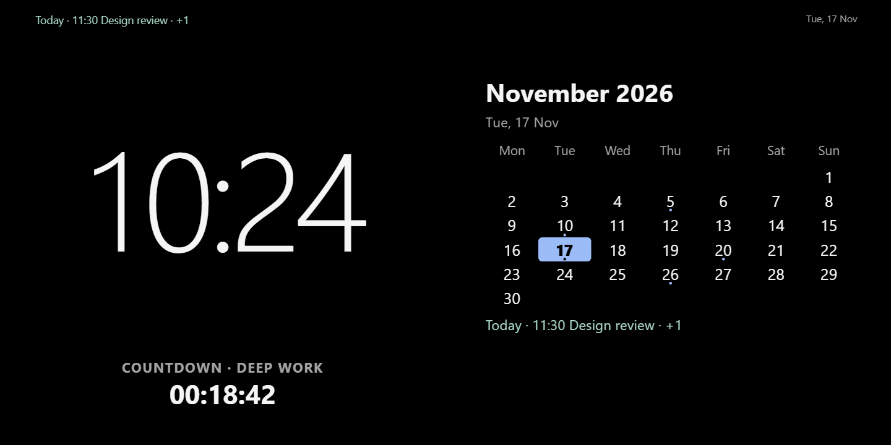
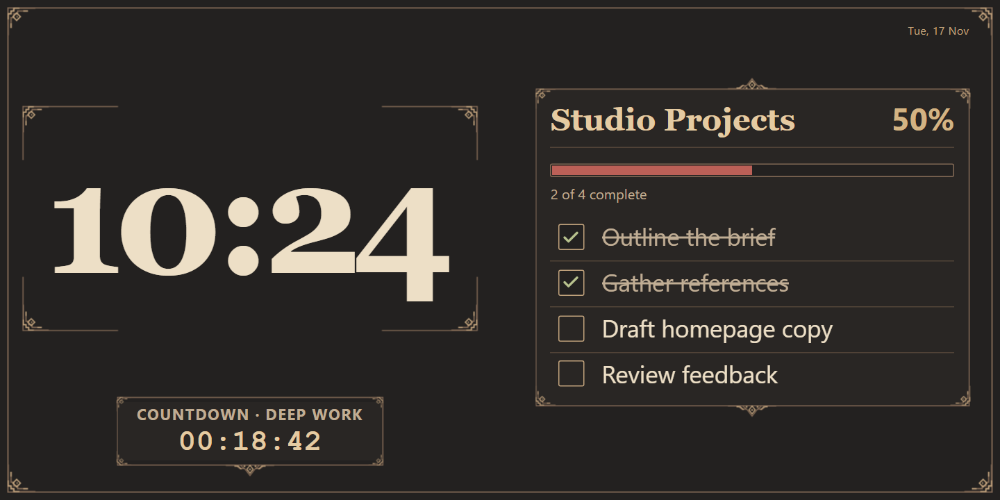

<h1 align="center">Standby - Personal Productivity Dashboard</h1>

<p align="center"><strong>A second life for your spare Android phone.</strong></p>

<p align="center">
  Turn an unused Android phone into a wall-mounted, always-on productivity dashboard.<br>
  Keep the time, your calendar, and the work you’re focusing on in view.
</p>

<p align="center">
  
  
  
</p>

## AMOLED Minimal



True black, the Modern Digital clock face, and a month at a glance.

## Dark Fantasy RPG



Bronze framing, the Fantasy Pixel clock face, and an active quest list with its own progress bar.

## Features

### Dashboard and appearance

- **Landscape by design.** A large clock and compact timer sit beside the widget carousel. Swipe horizontally between pages and vertically to switch widgets. Double-tap a widget to expand it.
- **Make it yours.** Switch between AMOLED Minimal and Dark Fantasy RPG. Hold the clock to choose from eight faces and adjust the time format, seconds, and supported accent colors.
- **Choose your widgets.** Enable and reorder Tasks, Progress, Calendar, Focus, Quote, Sanctuary, Spotify, and Notifications. The last two use a paired Android phone.

### Plans, tasks, and focus

- **Quest Hub.** Organize nested tasks and subtasks into categories. Each category tracks its own progress, and the active list appears on Standby.
- **Focus timer.** Run a countdown with presets or a custom duration, or use the stopwatch. Optionally link a session to a task and review daily totals and recent sessions.
- **Calendar.** Create local events, browse the monthly agenda, and see event indicators on the widget. Optionally show read-only events from selected device calendars after granting Android calendar access.

### Media, reminders, and display

- **Sanctuary.** Import photos and videos into a local library and view them fullscreen with saved fit, fill, and video audio settings. Playback depends on the device’s supported codecs.
- **Voice reminders.** Schedule one-time, daily, or interval reminders with an on-screen alert and Android text-to-speech. Spoken alerts use an installed offline voice. Delivery depends on Standby being active.
- **Display protection.** The Android dashboard supports both landscape positions and keeps the screen awake while visible. Periodic pixel shifting and inactivity dimming help reduce OLED wear.
- **Backup export.** Save tasks, local events, focus history, reminders, and display preferences as JSON. The export is one-way and excludes imported media and device calendar data.

### Connected phone

- **Notifications and ringing.** Mirror selected apps and see incoming mobile or supported app-call alerts. Control previews and how long items stay in the dashboard inbox.
- **Spotify.** See the current track and available artwork on the Spotify page or widget. Play, pause, skip, or seek when the sender’s Android Spotify session exposes those controls.

## How it works

**One phone.** The Android app ships with the web assets it needs to run offline. Dexie stores tasks, local events, reminders, timer state, and focus history in IndexedDB. Capacitor Preferences stores lightweight settings. Sanctuary keeps media in origin-private files where supported, with an IndexedDB fallback.

**Two phones, optionally.** A second Android phone runs as the **Phone sender** while the mounted phone runs as the **Dashboard receiver**. The devices find each other on reachable local Wi-Fi and use mutual TLS with Android Keystore identities. A pairing code and receiver approval establish trust. Paired devices can reconnect while the link is running. Alerts and artwork stay in memory, and the connection runs directly between the phones.

## Technology stack

- **Frontend** — React and strict TypeScript for the interface, React Router for navigation, and Vite for development and builds.
- **Styling** — Tailwind CSS and shared CSS theme tokens for the landscape layout and both visual themes.
- **Persistence** — Dexie and IndexedDB for structured data and migrations, Capacitor Preferences for settings, and origin-private file storage for media.
- **Android** — Capacitor bridges the web UI to Java and Android SDK APIs for display, calendar, speech, backup export, and phone sharing.
- **Phone link** — Android DNS-SD discovery, Android Keystore device identities, and mutual TLS for direct communication.
- **Development and testing** — Oxlint, Node’s test runner, fake-indexeddb, and browser and Android regression suites.

## Getting started

Use **Node.js 24** and **npm**. For Android builds, also install **JDK 21** and use Android Studio’s SDK Manager to install **SDK Platform 36**, **Build Tools 36.0.0**, and **Platform Tools**.

### Run locally

```sh
git clone https://github.com/Sanchit26/Standby_Phone.git
cd Standby_Phone
npm ci
npm run dev
```

Open the URL Vite prints and use a landscape viewport. The web build lets you try the dashboard and local features. The paired-phone connection and device calendar access require Android.

### Build and install on Android

Configure the JDK and Android SDK, then run these commands from the repository root in PowerShell.

```powershell
npm run build
npx cap sync android
Push-Location android
.\gradlew.bat :app:assembleDebug
Pop-Location
```

Find the debug APK at `android/app/build/outputs/apk/debug/app-debug.apk`. It supports **Android 7.0 (API 24)** and later. Copy the APK to the phone and open it in Files, or install it on a device authorized for USB debugging.

```powershell
adb install -r .\android\app\build\outputs\apk\debug\app-debug.apk
```

## Android phone connectivity

1. Install the APK on both Android phones and connect them to the same Wi-Fi network with device-to-device access.
2. In **Settings → Phone Connection**, select **Dashboard receiver** on the mounted phone and **Phone sender** on the other.
3. On the sender, grant **Notification Access**, select the apps to mirror, and turn on the sharing options you want. Mobile ringing also requires **Phone state** access. Spotify needs an accessible Android media session on the sender.
4. Tap **Start receiver**. Enter its complete pairing code on the sender, tap **Start sharing**, then approve the sender on the dashboard.

Android and third-party apps control which notifications, caller details, and media actions are available. See the guide for manual IP pairing, privacy settings, permission details, and device checks. [Phone Connection guide](docs/USER_AND_DEVELOPER_GUIDE.md#phone-connection)

## Additional documentation

- Build and installation details, usage, architecture, troubleshooting, and device validation. [User and developer guide](docs/USER_AND_DEVELOPER_GUIDE.md)
- Project milestones and planned work. [Development plan](docs/DEVELOPMENT_PLAN.md)
